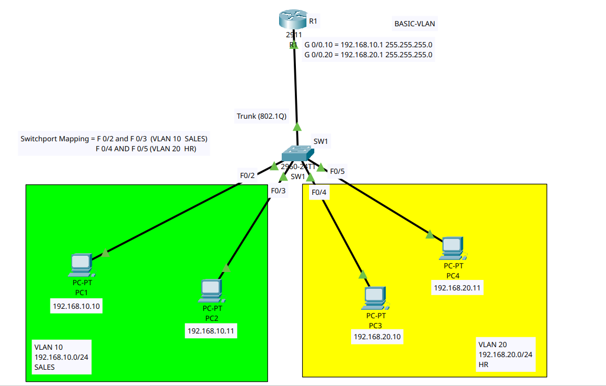
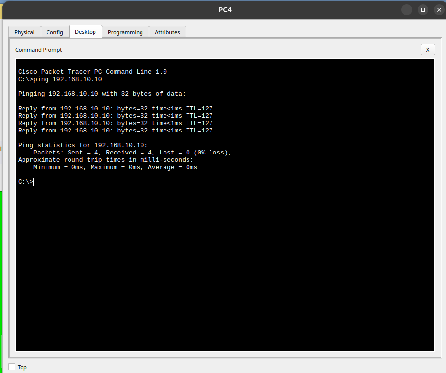
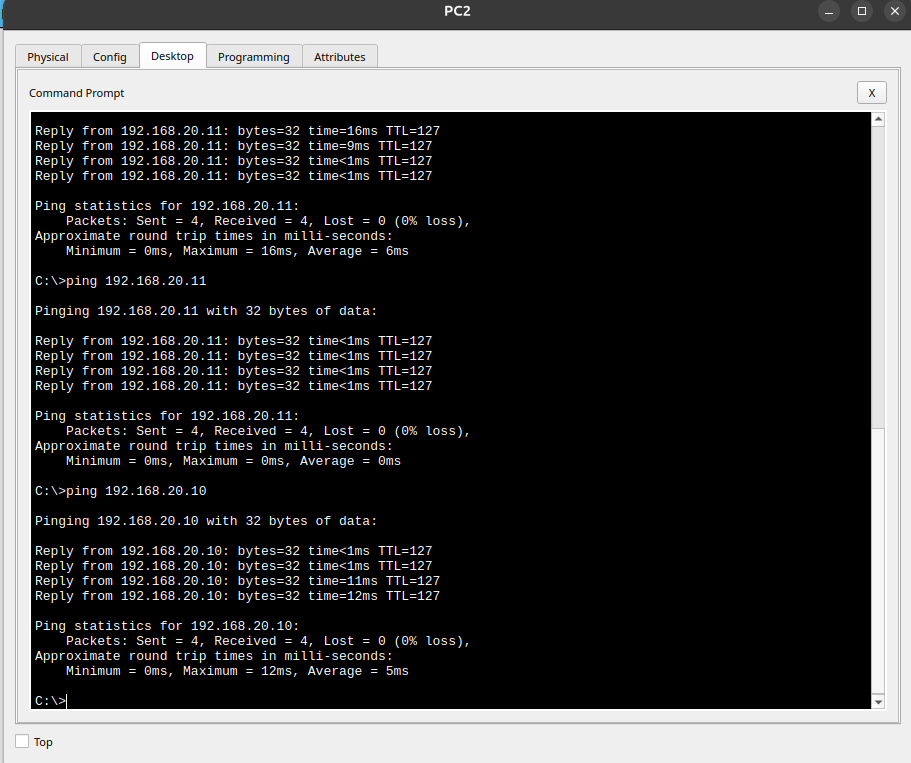

# Lab 01: Basic VLAN and Inter-VLAN Routing Setup

This lab demonstrates how to configure basic **VLANs (Virtual Local Area Networks)** and **Inter-VLAN Routing (Router-on-a-Stick)** using a Cisco 2911 Router and 2960 Switch.

---

## 📐 Topology Diagram

---

## 📊 IP Addressing Table

| Device | Interface | IP Address | Subnet Mask | Default Gateway | VLAN / Purpose |
| :--- | :--- | :--- | :--- | :--- | :--- |
| **R1** | G0/0.10 | 192.168.10.1 | 255.255.255.0 | N/A | Gateway for VLAN 10 |
| **R1** | G0/0.20 | 192.168.20.1 | 255.255.255.0 | N/A | Gateway for VLAN 20 |
| **SW1** | F0/1 | Configured as 802.1Q Trunk Link | N/A | Connected to R1 G0/0 |
| **PC1** | NIC | 192.168.10.10 | 255.255.255.0 | 192.168.10.1 | VLAN 10 (SALES) |
| **PC2** | NIC | 192.168.10.11 | 255.255.255.0 | 192.168.10.1 | VLAN 10 (SALES) |
| **PC3** | NIC | 192.168.20.10 | 255.255.255.0 | 192.168.20.1 | VLAN 20 (HR) |
| **PC4** | NIC | 192.168.20.11 | 255.255.255.0 | 192.168.20.1 | VLAN 20 (HR) |

---

## 🛠️ Configuration Files

- **Router Configuration File:** [`R1.txt`](R1.txt)
- **Switch Configuration File:** [`SW1.txt`](SW1.txt)
- **Packet Tracer File:** [`lab.pkt`](lab.pkt)

---

## 🧪 Verification & Ping Results

Inter-VLAN routing was verified by performing ping tests across different VLANs:

### 1. Ping from PC4 (VLAN 20) to PC1 (VLAN 10)

### 2. Ping from PC2 (VLAN 10) to PC3 & PC4 (VLAN 20)

> **Result:** All packets successfully sent with **0% packet loss**, confirming that Inter-VLAN routing is functioning as expected.
