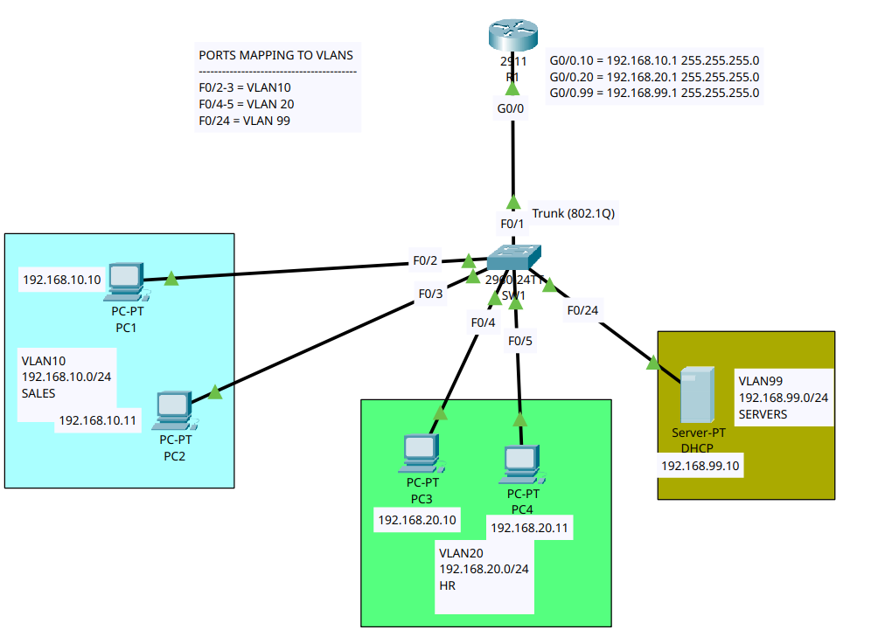
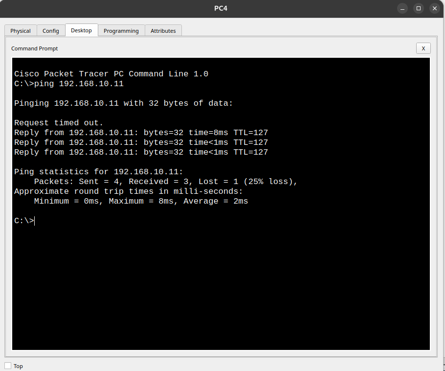
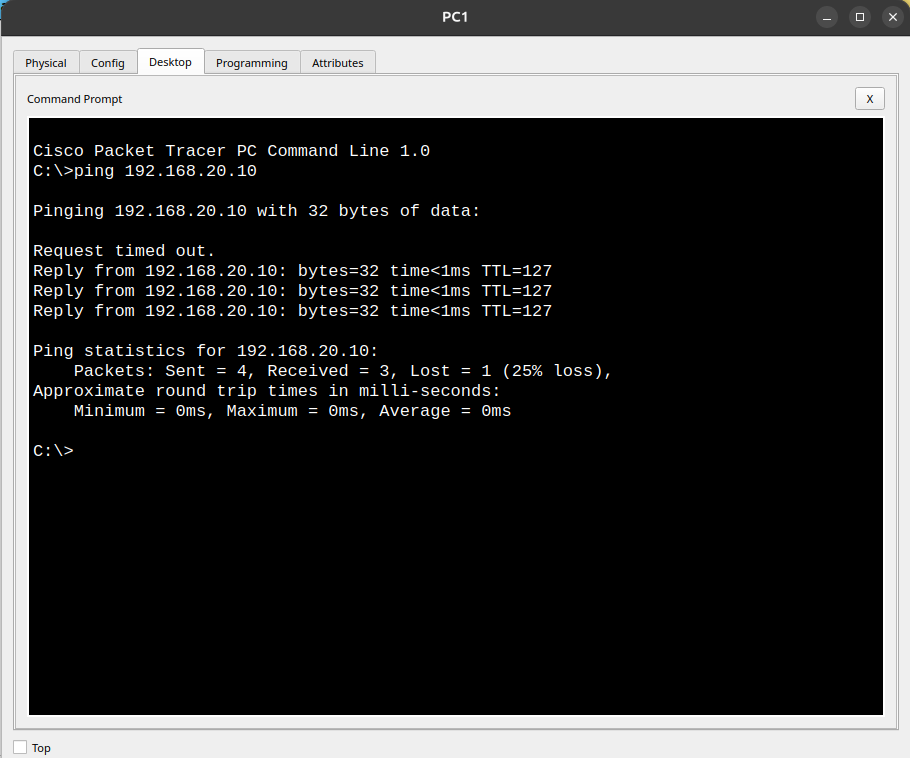

# Lab 02: DHCP Server & Helper Address (DHCP Relay Agent) Setup

This lab demonstrates how to configure a centralized **DHCP Server** in a separate VLAN (VLAN 99) to dynamically assign IP addresses to client PCs across different VLANs (VLAN 10 and VLAN 20) using the **`ip helper-address`** command on a Cisco Router (Router-on-a-Stick setup).

---

## 📐 Topology Diagram

---

## 📊 IP Addressing & Port Mapping Table

| Device | Interface | IP Address / Type | Subnet Mask | VLAN / Description |
| :--- | :--- | :--- | :--- | :--- |
| **DHCP Server** | FastEthernet0 | `192.168.99.10` | `255.255.255.0` | VLAN 99 (Servers) |
| **R1** | G0/0.10 | `192.168.10.1` | `255.255.255.0` | Gateway & DHCP Relay for VLAN 10 |
| **R1** | G0/0.20 | `192.168.20.1` | `255.255.255.0` | Gateway & DHCP Relay for VLAN 20 |
| **R1** | G0/0.99 | `192.168.99.1` | `255.255.255.0` | Native Gateway for VLAN 99 |
| **SW1** | F0/1 | Trunk Link (802.1Q) | N/A | Uplink to Router R1 G0/0 |
| **SW1** | F0/2 - F0/3 | Access Ports | N/A | VLAN 10 (SALES: PC1, PC2) |
| **SW1** | F0/4 - F0/5 | Access Ports | N/A | VLAN 20 (HR: PC3, PC4) |
| **SW1** | F0/24 | Access Port | N/A | VLAN 99 (DHCP Server) |
| **PC1 - PC4** | NIC | Dynamic (DHCP) | Dynamic (DHCP) | Client Workstations |

---

## 🛠️ Configuration Files

- **Router Configuration:** [`R1.txt`](R1.txt)
- **Switch Configuration:** [`SW1.txt`](SW1.txt)
- **Packet Tracer File:** [`lab.pkt`](lab.pkt)

---

## 🧪 Verification & Ping Results

After configuring DHCP pools on the server and `ip helper-address` on the router sub-interfaces, connectivity and inter-VLAN routing were successfully tested:

### 1. Ping Test from PC4 (VLAN 20) to PC2 (VLAN 10)

### 2. Ping Test from PC1 (VLAN 10) to PC3 (VLAN 20)

> **Conclusion:** Dynamic IP allocation via DHCP Relay and Inter-VLAN communication between SALES and HR networks are working successfully with stable packet transmission!
