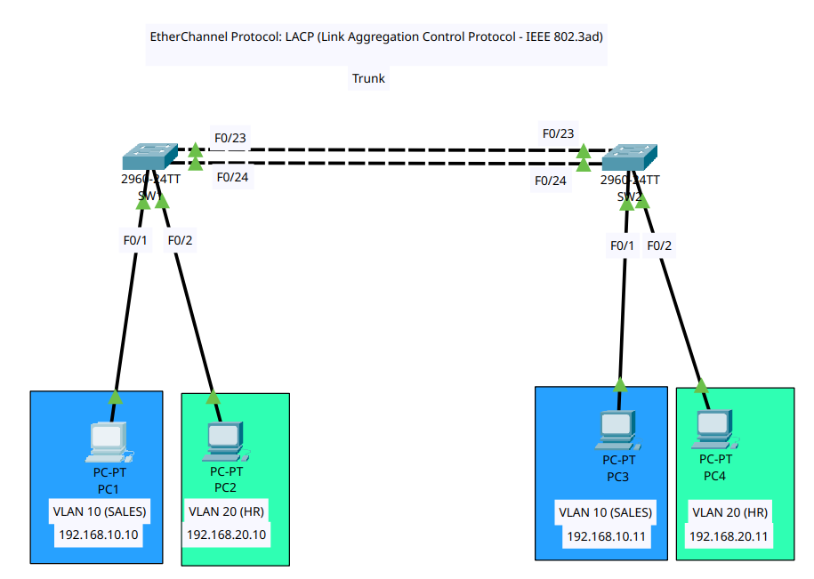
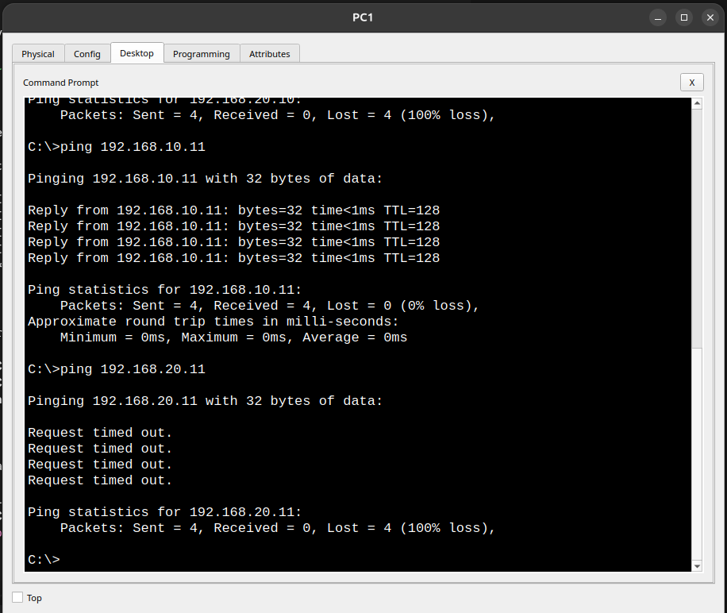

# Lab 03: EtherChannel / Link Aggregation (LACP) Setup

This lab demonstrates how to configure **LACP (Link Aggregation Control Protocol - IEEE 802.3ad)** on Cisco Switches to bundle multiple physical interfaces (`FastEthernet0/23` & `FastEthernet0/24`) into a single logical interface (**Port-Channel 1**). This increases link bandwidth and provides automatic link redundancy across VLAN trunks.

---

## 📐 Topology Diagram

---

## 📊 IP Addressing & VLAN Port Mapping Table

| Device | Interface | IP Address | Subnet Mask | VLAN / Purpose |
| :--- | :--- | :--- | :--- | :--- |
| **PC1** | NIC | `192.168.10.10` | `255.255.255.0` | Connected to SW1 F0/1 (VLAN 10 - SALES) |
| **PC2** | NIC | `192.168.20.10` | `255.255.255.0` | Connected to SW1 F0/2 (VLAN 20 - HR) |
| **PC3** | NIC | `192.168.10.11` | `255.255.255.0` | Connected to SW2 F0/1 (VLAN 10 - SALES) |
| **PC4** | NIC | `192.168.20.11` | `255.255.255.0` | Connected to SW2 F0/2 (VLAN 20 - HR) |
| **SW1 & SW2** | `F0/23` & `F0/24` | Bundled in `Port-channel 1` | N/A | LACP Active Trunk Link (802.1Q) |

---

## 🛠️ Configuration Files

- **Switch 1 Configuration:** [`SW1.txt`](SW1.txt)
- **Switch 2 Configuration:** [`SW2.txt`](SW2.txt)
- **Packet Tracer File:** [`lab.pkt`](lab.pkt)

---

## 🧪 Verification & Results

### 1. Same VLAN Ping Verification (PC1 to PC3)
Ping from **PC1** (`192.168.10.10`) to **PC3** (`192.168.10.11`) across the EtherChannel Trunk link:

> **Result:** `Reply from 192.168.10.11` with **0% packet loss**, confirming that the EtherChannel bundle (Port-channel 1) is passing tagged VLAN traffic across switches successfully.

### 2. Cross-VLAN Isolation Verification (PC1 to PC4)
Ping from **PC1** (`192.168.10.10` - VLAN 10) to **PC4** (`192.168.20.11` - VLAN 20):
> **Result:** `100% loss (Request timed out)`. This behavior is expected as Layer 2 switches maintain strict VLAN segmentation without a Layer 3 routing device.
