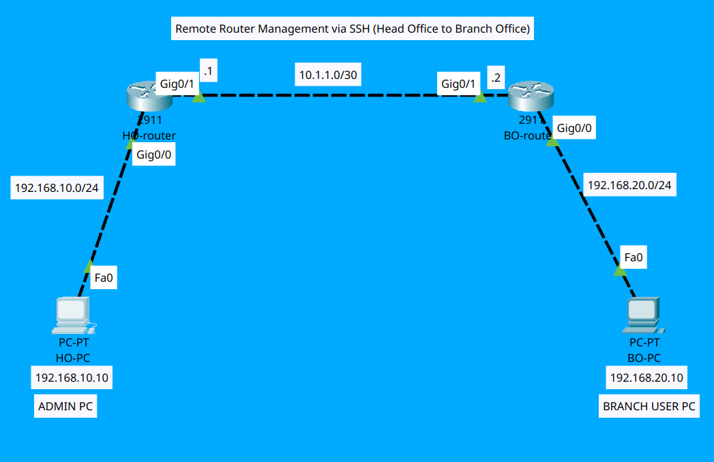

# Lab 05: Remote Router Management via SSH (Head Office to Branch Office)

This lab demonstrates how to securely manage a remote **Branch Office Router (`BO-Router`)** from a **Head Office Admin PC (`HO-PC`)** using **SSH (Secure Shell v2)** across a WAN link.

---

## 📐 Topology Diagram



---

## 📊 IP Addressing & Device Mapping Table

| Device | Interface | IP Address | Subnet Mask | Role / Description |
| :--- | :--- | :--- | :--- | :--- |
| **HO-PC** | NIC | `192.168.10.10` | `255.255.255.0` | Head Office Network Admin PC |
| **HO-Router**| G0/0 | `192.168.10.1` | `255.255.255.0` | Gateway for Head Office LAN |
| **HO-Router**| G0/1 | `10.1.1.1` | `255.255.255.252` | Point-to-Point WAN Interface |
| **BO-Router**| G0/1 | `10.1.1.2` | `255.255.255.252` | SSH Server Target Interface |
| **BO-Router**| G0/0 | `192.168.20.1` | `255.255.255.0` | Gateway for Branch Office LAN |
| **BO-PC** | NIC | `192.168.20.10` | `255.255.255.0` | Branch Office Client PC |

---

## 🛠️ Configuration Files

- **HO Router Config:** [`HO-Router.txt`](HO-Router.txt)
- **BO Router SSH Config:** [`BO-Router.txt`](BO-Router.txt)
- **Packet Tracer File:** [`lab.pkt`](lab.pkt)

---

## 🧪 Verification & Remote SSH Execution

1. **Test WAN Connectivity:**
   ```bash
   C:\> ping 10.1.1.2

- **HQ-ADMIN-PC:** ['SSH.PNG'](SSH.png)
- **BO-PC:** ['ping.png'](ping.png)   
