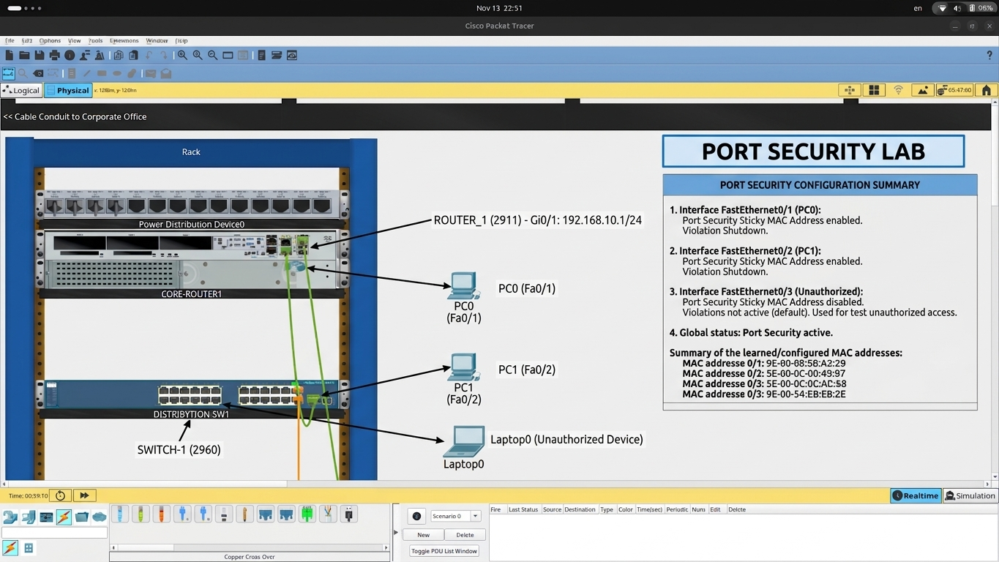
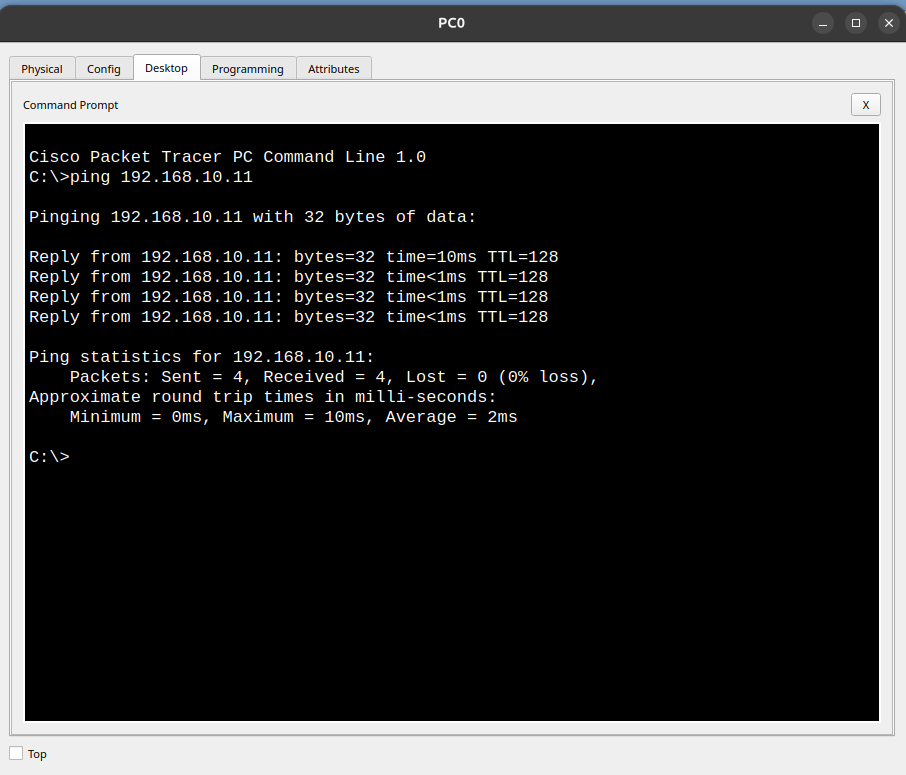
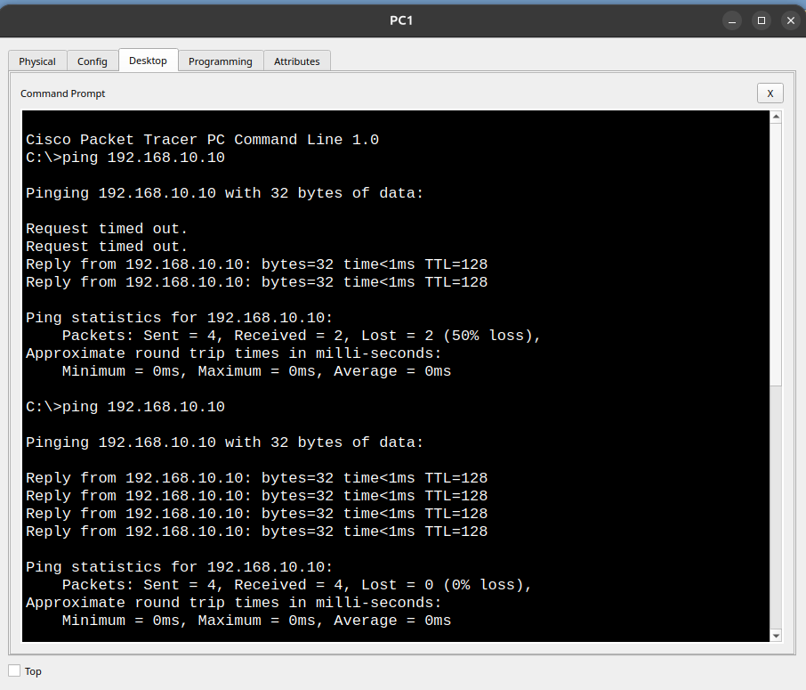
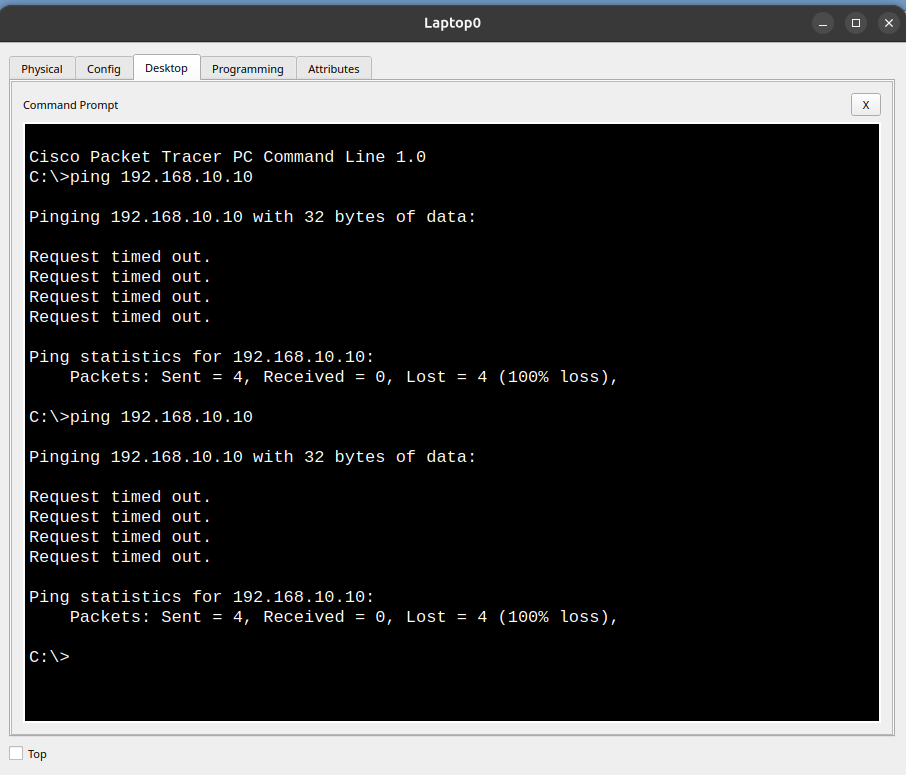

# 🛡️ Cisco Switch Port Security Lab (Packet Tracer Physical Mode)



## 📌 Project Overview
This project demonstrates Layer 2 access port protection using **Cisco Port Security** with **Sticky MAC Address** learning in Cisco Packet Tracer's Physical Workspace mode. Authorized workstations (`PC0` and `PC1`) communicate normally across the network, while any unauthorized device (`Laptop0`) attempting to connect to a secured port triggers a security violation and is blocked.

---

## 🖥️ Network Architecture & IP Addressing

| Device | Model | Interface | IP Address / Subnet | Role & Security Status |
| :--- | :--- | :--- | :--- | :--- |
| **ROUTER_1** | Cisco 2911 | `GigabitEthernet0/1` | `192.168.10.1 /24` | Default Gateway for LAN |
| **SWITCH-1** | Cisco 2960 | `FastEthernet0/1` | Layer 2 Access | Connected to `PC0` (**Port Security: Sticky MAC, Shutdown**) |
| **SWITCH-1** | Cisco 2960 | `FastEthernet0/2` | Layer 2 Access | Connected to `PC1` (**Port Security: Sticky MAC, Shutdown**) |
| **PC0** | End Device | `FastEthernet0` | `192.168.10.10 /24` | Authorized Workstation |
| **PC1** | End Device | `FastEthernet0` | `192.168.10.11 /24` | Authorized Workstation |
| **Laptop0** | End Device | `FastEthernet0` | `192.168.10.x /24` | Unauthorized Test Device (Blocked on Violation) |

---

## ⚙️ Configuration Files
* **[Router Configuration](ROUTER-1.txt)** — Configures `GigabitEthernet0/1` (`192.168.10.1/24`) as the LAN gateway.
* **[Switch Configuration](SWITCH-1.txt)** — Enables access mode, sticky MAC learning (`maximum 1`), and `shutdown` violation mode on `FastEthernet0/1` and `FastEthernet0/2`.

---

## 🧪 Verification & Ping Test Results

### 1. Authorized Communication (`PC0` $\leftrightarrow$ `PC1`)
Both `PC0` (`192.168.10.10`) and `PC1` (`192.168.10.11`) have their MAC addresses dynamically learned and bound to their respective switch ports (`Fa0/1` and `Fa0/2`). Connectivity between them succeeds with **0% packet loss**.

* **PC0 Pinging PC1 (`192.168.10.11`):**
  

* **PC1 Pinging PC0 (`192.168.10.10`):**
  

---

### 2. Unauthorized Access Test (`Laptop0` Blocked)
When the unauthorized device (`Laptop0`) is connected to a secured switch port, the MAC address mismatch triggers a port-security violation, immediately shutting down the interface (`err-disabled` state) and dropping all traffic (**100% packet loss**).

* **Laptop0 Pinging PC0 (`192.168.10.10`) — Request Timed Out:**
  

---

## 🔍 Useful Troubleshooting Commands
```cisco
show port-security
show port-security interface FastEthernet0/1
show port-security interface FastEthernet0/2
show port-security address
show interfaces status err-disabled
